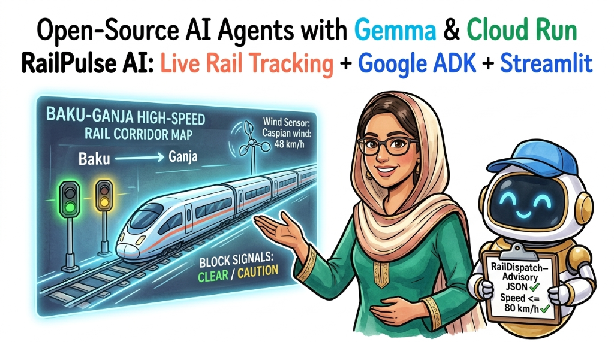
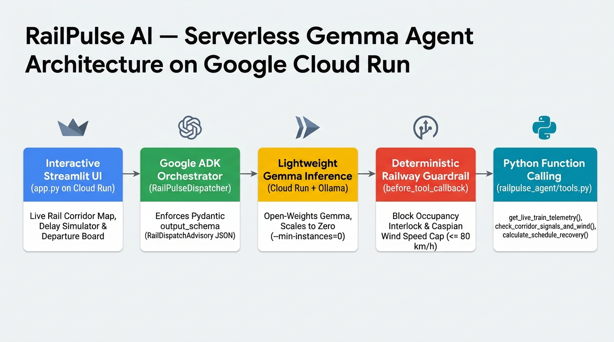
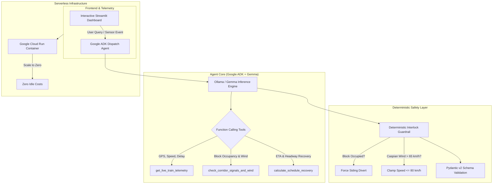

# 🚆 RailPulse AI — Building & Deploying Open-Source AI Agents with Gemma and Google Cloud Run (DevFest Baku 2026)



> **Accepted 45-Minute Hands-On Workshop — DevFest Baku 2026**  
> **Speaker:** [Robina Mirbahar](https://github.com/RobinaMirbahar) (Google Developer Expert in Cloud & AI)  
> **Topic:** Building, containerizing, and deploying a production-ready railway dispatch and tracking AI agent powered by open-weights Gemma, Google ADK, and Google Cloud Run with zero idle costs.

---

## 🎯 Why I Created This Documentation (Purpose & Real-World Value)

Most generative AI tutorials showcase toy chatbots, creative writing prompts, or basic customer service bots. **RailPulse AI addresses a fundamentally different and much higher-stakes engineering challenge: how to build AI agents for safety-critical physical infrastructure.**

Here is why this documentation and architecture are essential:

### 1. 🛡️ Moving Beyond "Toy Demos" to Safety-Critical AI
In passenger rail systems (like Azerbaijan Railways), a single hallucinated route or ignored signal can cause catastrophe. This documentation demonstrates how to wrap open-weights models (Gemma) inside **deterministic, non-negotiable software interlocks** (`guardrails.py`) so physical safety rules always take precedence over AI suggestions.

### 2. 💰 Privacy, Data Sovereignty & $0 Idle Serverless Economics
Many enterprise organizations cannot stream sensitive internal operational telemetry, crew rosters, or signal logs to closed third-party cloud APIs. By using **Gemma open-weights models** hosted on **Google Cloud Run with scale-to-zero (`--min-instances 0`)**, teams retain 100% data privacy and control while paying **$0 when the application is idle**.

### 3. 🧭 Dual-Purpose: Live Presentation Playbook & Self-Paced Blueprint
- **For DevFest Baku 2026 Attendees:** Acts as the live step-by-step companion guide during the 45-minute interactive workshop.
- **For the Open-Source Community:** Serves as a reference implementation demonstrating how to combine **Google Agent Development Kit (ADK)**, **Pydantic v2 structured JSON schemas**, **Streamlit**, and **Cloud Run** in production.

---

## 🌟 Live Interactive Rail Tracking & Smart Dispatch Demo (Baku 2026)

**RailPulse AI** provides a complete, live interactive rail tracking experience built specifically for my hands-on workshop at **DevFest Baku 2026**.

The live demo features a real-time tracking map and operational dashboard modeled after modern railway transit systems across the **Azerbaijan Railways (ADY)** network:
- **Live GPS & Track Telemetry:** Track active passenger trains (*Baku–Ganja High-Speed Express*, *Baku–Sumgayit Absheron Commuter*, *Baku–Tbilisi Silk Road Express*) moving across real coordinates.
- **Dynamic Station Departure Boards:** Live estimated arrival times (ETAs), delay counters, and track assignments.
- **Interactive Weather & Track Simulator:** Attendees can toggle Caspian coastal crosswinds and block occupancies in real time.
- **Autonomous Dispatch Agent:** When disruptions occur, the open-weights **Gemma** agent assesses options and issues collision-free, guardrail-verified rerouting advisories without ever violating physical railway safety interlocks.

---

## 🏗️ Architecture Overview





---

## ⏱️ 45-Minute Hands-On Workshop Lab Guide (Step-by-Step for Students)

I designed every step with four clear answers:
1. **📌 What is this step?**
2. **❓ Why is this used?**
3. **🔗 How does this connect to the complete system?**
4. **💻 What commands to run & what you see on screen.**

```
Step 1: Cloud Shell Setup ──> Step 2: Gemma Tools ──> Step 3: Safety Guardrails ──> Step 4: Web Dashboard ──> Step 5: Live Cloud Run
 (Free Browser Machine)       (Live Train Sensors)      (Zero-Collision Rules)      (Interactive UI Map)       (Scale-to-$0 Public URL)
```

---

### ❓ Where Does This Code Come From? (How I Architected This Workshop)

> [!NOTE]
> **For Workshop Students & Beginners:**  
> In this 45-minute workshop, **you do not need to write thousands of lines of code from scratch**.  
> - **The Code is Already Pre-Built:** All components (Gemma agent, safety interlocks, Streamlit UI, Dockerfile) were pre-engineered and published in this repository ([`RobinaMirbahar/railpulse-gemma-cloudrun`](https://github.com/RobinaMirbahar/railpulse-gemma-cloudrun)).
> - **Cloud Shell Clones (Extracts) It:** When you click the 1-click launch button in Step 1, Google Cloud Shell automatically downloads (clones) this complete codebase into your session.
> - **`pip install` Downloads Libraries:** Running `pip install -r requirements.txt` downloads the official Python runtime packages (`google-adk`, `streamlit`, `pydantic`) from PyPI directly into your virtual environment so everything runs immediately.

---

### 📍 Step 1: Google Cloud Shell Environment Setup (00:00 – 05:00)

- **📌 What is this step?** Launching a browser-based Linux developer environment provided by Google Cloud and downloading the RailPulse AI code.
- **❓ Why is this used?** Attendees have different laptops (Windows, macOS, Linux, Chromebooks) with different software versions. Google Cloud Shell provides a 100% free, identical Linux machine in your browser with `gcloud`, Python 3.11, and Docker pre-installed—so nobody has to troubleshoot local setup errors.
- **🔗 How does this connect?** This creates the clean workspace where you will inspect Gemma's tools (Step 2), test safety rules (Step 3), launch the web UI (Step 4), and deploy the container (Step 5).

#### 💻 Actions:

[](https://shell.cloud.google.com/cloudshell/editor?cloudshell_git_repo=https://github.com/RobinaMirbahar/railpulse-gemma-cloudrun.git)

1. Click the blue **Open in Google Cloud Shell** button above.
2. When the **Open in Cloud Shell** confirmation dialog appears:
   - Check the box **☑️ Trust repo**
   - Click **Confirm**

<br>

> 📸 **[Console Screenshot: Step 1.1 — Trust Repo & Confirm]**


<br>

3. When the **Authorize Cloud Shell** popup appears:
   - Click **Authorize** to allow Cloud Shell to use your credentials for Google Cloud commands.

<br>

> 📸 **[Console Screenshot: Step 1.2 — Authorize Cloud Shell]**


<br>

4. Verify your active project in the terminal:
```bash
gcloud auth list
gcloud config set project $(gcloud config get-value project)
```

3. Clone and enter the repository:
```bash
git clone https://github.com/RobinaMirbahar/railpulse-gemma-cloudrun.git
cd railpulse-gemma-cloudrun
```


4. Create and activate a Python virtual environment and install dependencies:
```bash
python3 -m venv .venv
source .venv/bin/activate
pip install -r requirements.txt
```

<br>

> 📸 **[Console Screenshot: Virtual Environment Creation & Dependency Installation]**


<br>

> 💡 **Why create a Virtual Environment (`.venv`)?**
>
> 1. **Dependency Isolation:** Google Cloud Shell comes with many system-wide Linux packages. Creating `.venv` creates an isolated sandbox for RailPulse AI's libraries (`google-adk`, `streamlit`, `pydantic`), preventing version conflicts with the underlying operating system.
> 2. **Clean Container Parity:** What runs inside `.venv` matches the exact dependencies packaged into the Google Cloud Run Docker container in Step 5, eliminating "works on my machine" deployment bugs.
> 3. **Permission Safety:** It allows packages to be installed cleanly in user space without requiring `sudo` or altering system-level Linux binaries.

---

### 📍 Step 2: Equipping Gemma with Live Railway Telemetry Tools (05:00 – 15:00)

- **📌 What is this step?** Giving Google's open-weights Gemma model access to live Python functions that read train speeds, GPS coordinates, block signals, and weather.
- **❓ Why is this used?** An AI language model on its own only knows text; it has zero real-time awareness of where trains are. Just like live railway transit maps connect to GPS signals to display real-time positions, the Gemma agent uses **Function Calling** to inspect live sensors before generating any dispatch decision.
- **🔗 What is the link?** Takes the environment prepared in **Step 1** and gives Gemma the live data it needs so that **Step 3** can evaluate whether those conditions are physically safe.

#### 💻 How It Works (`railpulse_agent/tools.py`):
- `get_live_train_telemetry(train_id)`: Queries live train speed (`km/h`), delay (`minutes`), and track block (e.g. *Baku–Ganja Express* `ADY-EXP-101`).
- `check_corridor_signals_and_wind(corridor_id)`: Checks whether downstream track blocks are `FREE` or `OCCUPIED` and checks Caspian coastal crosswinds.
- `calculate_schedule_recovery(train_id, target_speed_kmh, use_passing_siding)`: Calculates timetable adjustments and headway recovery.

Run the terminal demonstration to see Gemma calling these tools:
```bash
python scripts/run_demo.py
```

<br>

> 📸 **[Your Console Screenshot Here]**  
> *Capture your Google Cloud Shell terminal output showing Gemma executing the function calling tools and printing the telemetry values.*


<br>

---

### 📍 Step 3: Enforcing Deterministic Safety Guardrails & Schemas (15:00 – 25:00)

- **📌 What is this step?** Wrapping Gemma's output in non-negotiable software interlocks (`guardrails.py`) and a strict JSON data schema (`schemas.py`).
- **❓ Why is this used?** In mission-critical railway operations, an AI hallucination could cause a collision or derailment. A language model must **never** have the final say on physical safety. If a track is blocked, a software guardrail must *physically force* a diversion regardless of what the LLM generated.
- **🔗 What is the link?** Protects the telemetry gathered in **Step 2** from hallucinations and outputs a strictly verified `RailDispatchAdvisory` JSON object that **Step 4** can safely render on a visual map.

#### 🛡️ The Two Non-Negotiable Safety Rules:
1. **Block Collision Interlock:** If the main line block is `OCCUPIED`, the agent strictly overrides any forward clearance and diverts the train into a verified `FREE` passing loop siding (`BLK-BILAJARI-SIDING-S1`).
2. **Caspian Wind Speed Cap:** If crosswinds off the Caspian Sea exceed `65 km/h`, the speed advisory is capped to `<= 80 km/h` to prevent aerodynamic instability.

Run the automated test suite to verify the guardrails block hallucinations:
```bash
pytest tests/test_railpulse.py -v
```

<br>

> 📸 **[Your Console Screenshot Here]**  
> *Capture your terminal showing all unit tests passing (green) for `test_corridor_signals_and_wind`, `test_block_occupancy_guardrail`, and `test_high_wind_clamp`.*

<br>

---

### 📍 Step 4: Launching the Interactive Web Rail Tracker & Simulator (25:00 – 35:00)

- **📌 What is this step?** Launching an interactive Streamlit web dashboard in Cloud Shell that displays train positions on a map, live departure boards, and a 1-click **Caspian Wind & Block Occupancy Simulator**.
- **❓ Why is this used?** Train dispatchers and station masters cannot operate by reading raw command-line JSON. They need an interactive visual interface to see where trains are, test scenarios, and review the AI agent's recommendations in human-friendly format.
- **🔗 What is the link?** Connects the verified backend agent from **Steps 2 & 3** to a user-friendly frontend that students can click and explore before deploying to production in **Step 5**.

#### 💻 Actions:

Start the Streamlit application on port 8080:
```bash
streamlit run app.py --server.port=8080 --server.address=0.0.0.0
```

1. In the upper-right corner of Google Cloud Shell, click the **Web Preview** icon.
2. Select **Change port > 8080 > Preview and Run**.

<br>

> 📸 **[Your Live Demo Screenshot Here]**  
> *Capture the live Streamlit interactive dashboard showing the Azerbaijan Railways map, the active train coordinates, and the live Baku departure board.*


<br>

#### 🧪 Try This in the Dashboard:
- **Test High Winds:** Slide the Caspian Wind speed slider to `75 km/h`. Watch the guardrail automatically engage the `80 km/h` speed restriction.
- **Test Track Blockage:** Toggle Block 02 to `OCCUPIED`. Watch the agent immediately route the Baku–Ganja Express into the Bilajari passing siding.

---

### 📍 Step 5: Deploying to Google Cloud Run with Scale-to-Zero (35:00 – 45:00)

- **📌 What is this step?** Packaging the entire application into a Docker container and deploying it as a production serverless web service on Google Cloud Run.
- **❓ Why is this used?** Inside Cloud Shell, the app only runs while your browser tab is open. Cloud Run gives you a permanent, secure `https://...run.app` URL accessible from anywhere in the world. With `--min-instances 0`, Cloud Run automatically scales to zero instances when idle—meaning **students pay $0** after the workshop ends.
- **🔗 How does this connect?** Takes everything built in **Steps 1 through 4** (Gemma + Google ADK + Safety Guardrails + Streamlit UI) and turns it into a live public product for your portfolio or resume.

#### 💻 Actions:

[](https://deploy.cloud.run/?git_repo=https://github.com/RobinaMirbahar/railpulse-gemma-cloudrun.git)

1. Click the **Run on Google Cloud** button above, or run the automated script in your Cloud Shell terminal:
```bash
chmod +x deploy/deploy_cloud_run.sh
./deploy/deploy_cloud_run.sh
```

Or deploy directly via `gcloud`:
```bash
gcloud run deploy railpulse-gemma   --source .   --region europe-west1   --allow-unauthenticated   --memory 2Gi   --cpu 2   --min-instances 0   --max-instances 5
```

<br>

> 📸 **[Your Console Screenshot Here]**  
> *Capture your Google Cloud Shell terminal showing the Cloud Run deployment success, 100% traffic serving, and the active `https://...run.app` service URL.*


<br>

2. Open the printed **Service URL** in your browser:
```text
https://railpulse-gemma-xxxxxxxxxx-ew.a.run.app
```
Congratulations! You have built, verified, and deployed an open-source AI agent powered by Gemma on Google Cloud! 🎉


## 📁 Repository Structure

```text
railpulse-gemma-cloudrun/
├── app.py                      # Interactive Streamlit live rail tracking UI & simulator
├── Dockerfile                  # Container definition for Google Cloud Run
├── requirements.txt            # Python dependencies (streamlit, pydantic, google-genai)
├── pyproject.toml              # Build & test configuration
├── deploy/
│   └── deploy_cloud_run.sh     # One-click Cloud Run deployment script
├── railpulse_agent/
│   ├── __init__.py
│   ├── agent.py                # Google ADK agent orchestrator
│   ├── guardrails.py           # Deterministic railway safety interlocks
│   ├── schemas.py              # Pydantic v2 structured JSON advisory models
│   └── tools.py                # Telemetry, signal & timetable recovery tools
├── scripts/
│   └── run_demo.py             # CLI demonstration runner for terminal walkthroughs
├── tests/
│   └── test_railpulse.py       # Unit tests for tools, interlocks & schemas
└── assets/
    ├── railpulse_cover.jpg
    ├── railpulse_architecture.jpg
    └── screenshots/            # Step-by-step workshop screenshots (1 to 6)
```

<!-- AUTHOR_SIGNATURE_START -->
---

## 👩‍💻 About the Author

**Robina Mirbahar — Google Cloud & AI Architect**  
*Google Developer Expert (GDE) in Cloud & AI • Published Author • Multi-Agent Systems & Serverless GPU Builder*

[](https://github.com/RobinaMirbahar)
[](https://medium.com/@robinamirbahar)
[](https://dev.to/robinamirbahar)
[](https://www.linkedin.com/in/robina-mirbahar)
[](https://g.dev/RobinaMirbahar)
[](https://www.youtube.com/@RobinaMirbahar)
[](https://x.com/RobinaMirbahar)
[](https://www.amazon.com/dp/B0D146249R)

<!-- AUTHOR_SIGNATURE_END -->
