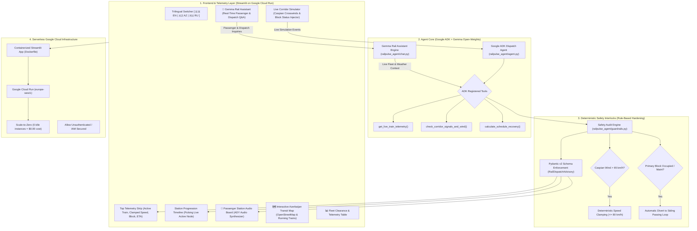
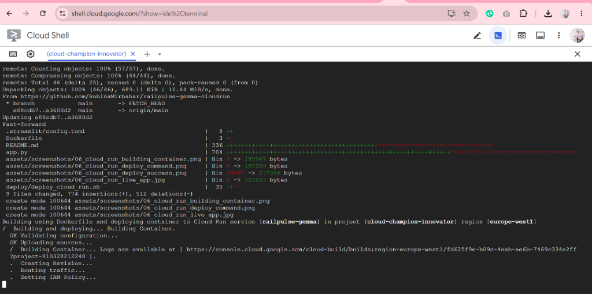
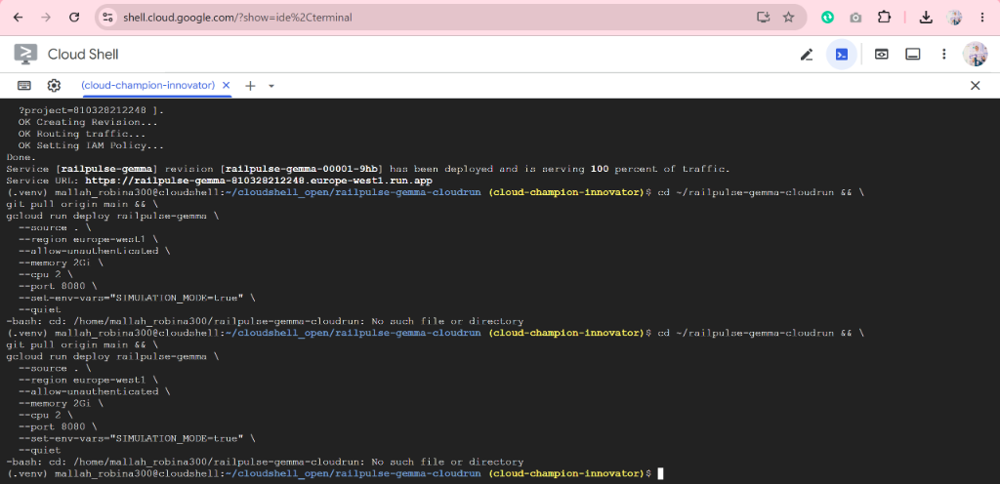

# 🚆 RailPulse AI — Building & Deploying Open-Source AI Agents with Gemma and Google Cloud Run (DevFest Baku 2026)


> **Accepted 45-Minute Hands-On Workshop — DevFest Baku 2026**  
> **Author & Speaker:** [Robina Mirbahar](https://github.com/RobinaMirbahar) (Google Developer Expert in Cloud & AI)  
> **Focus:** Designing, verifying, containerizing, and deploying a safety-critical railway dispatch and live tracking AI agent powered by open-weights **Gemma**, **Google Agent Development Kit (ADK)**, **Streamlit**, and **Google Cloud Run** with scale-to-zero serverless economics.

---

## 🎯 Why I Built RailPulse AI (Engineering Purpose & Real-World Value)

Most generative AI tutorials stop at conversational chatbots or basic text summarization. **I architected RailPulse AI to solve a fundamentally higher-stakes engineering challenge: deploying open-weights AI agents inside safety-critical physical infrastructure.**

### 1. 🛡️ Moving Beyond Toy Chatbots to Deterministic Physical Safety
In passenger rail networks like **Azerbaijan Railways (ADY)**, a hallucinated track assignment or ignored weather alert can have severe consequences. In this architecture, I wrap open-weights **Gemma** reasoning inside **deterministic, non-negotiable software interlocks** (`railpulse_agent/guardrails.py`) and strict **Pydantic v2 schemas** (`railpulse_agent/schemas.py`) so physical railway safety rules always override LLM suggestions.

### 2. 💰 Data Sovereignty & $0 Idle Serverless Economics
Transportation operators and enterprise teams often cannot stream internal operational telemetry or signal logs to proprietary third-party APIs. By combining **open-weights Gemma** with **Google Cloud Run configured for scale-to-zero (`--min-instances=0`)**, you retain full control over your stack while paying **$0.00 when the service is idle**.

### 3. 🌍 Built for Real Baku & Azerbaijan Operations (Trilingual: EN / AZ / RU)
I designed the operational dashboard and the interactive **Gemma Rail Assistant** to support **English (`EN`)**, **Azerbaijani (`AZ`)**, and **Russian (`RU`)**, reflecting real-world dispatch, passenger announcements, and transit inquiries across Baku, Sumgayit, Ganja, and the Silk Road corridor.

---

## 🌟 Key Capabilities in This Live Demo

- **🗺️ Highlighted Azerbaijan Live Transit Map:** Built with OpenStreetMap and Leaflet (requiring zero API keys), highlighting the Republic of Azerbaijan boundary and animating active trains (`🚆 ADY-104`, `⚡ ADY-702`, `🌍 ADY-410`) gliding along their rail corridors in real time.
- **🚉 Full-Width Station Progression Timeline:** Visualizes passed, active (pulsing live amber indicator), and upcoming stations along the selected corridor.
- **🎛️ Live Corridor Simulator:** Inject real-time **Caspian Sea *Khazri* crosswinds** (`10–110 km/h`) and toggle track block status (`FREE`, `OCCUPIED`, `MAINTENANCE`) to watch deterministic guardrails intervene automatically.
- **💬 Context-Aware Gemma Rail Assistant:** Interactive trilingual Q&A assistant that answers live schedule, delay recovery, ticket fare (`BakuCard` / contactless), onboard amenity (`Stadler KISS` Wi-Fi & power outlets), and airport-to-downtown transit questions (`Heydar Aliyev Airport GYD ➔ Baku Central 28 May ➔ Radisson Hotel`).
- **📢 Station Audio Announcement Synthesizer & Audit Logs:** Generates localized station platform announcements alongside a transparent Google ADK function-calling trajectory and validated JSON payload.

---

## 🏗️ System Architecture

I designed RailPulse AI with a clean four-layer separation between the **interactive trilingual operations frontend**, the **Google ADK + Gemma reasoning core**, **deterministic railway safety interlocks**, and **serverless Google Cloud Run hosting**.



### 🧩 Architectural Subsystem Index

| Subsystem | File Location | Engineering Responsibility |
| :--- | :--- | :--- |
| **Gemma Rail Assistant** | [`railpulse_agent/chat.py`](railpulse_agent/chat.py) | Context-aware trilingual passenger & dispatcher Q&A covering live delays, airport-to-city transit, fares, and onboard amenities. |
| **Google ADK Orchestrator** | [`railpulse_agent/agent.py`](railpulse_agent/agent.py) | Coordinates Gemma tool execution, ordered function trajectories, and dispatch advisory synthesis. |
| **Railway Telemetry Tools** | [`railpulse_agent/tools.py`](railpulse_agent/tools.py) | Provides live GPS coordinates, speeds, Caspian crosswind readings, and track block occupancy for `ADY-104`, `ADY-702`, and `ADY-410`. |
| **Deterministic Guardrails** | [`railpulse_agent/guardrails.py`](railpulse_agent/guardrails.py) | Enforces non-negotiable physical safety: clamping speeds when wind exceeds `65 km/h` and routing trains into passing sidings when blocks are occupied. |
| **Structured Output Schema** | [`railpulse_agent/schemas.py`](railpulse_agent/schemas.py) | Strict Pydantic v2 model (`RailDispatchAdvisory`) guaranteeing validated JSON output. |
| **Interactive Operations UI** | [`app.py`](app.py) | Streamlit command center with full-width KPI cards, station progression timeline, animated Leaflet rail map, and simulator controls. |
| **Serverless Containerization** | [`Dockerfile`](Dockerfile), [`deploy/deploy_cloud_run.sh`](deploy/deploy_cloud_run.sh) | Production container definition and automated Google Cloud Run deployment script. |

---

## ⏱️ 45-Minute Hands-On Lab Guide (End-to-End Walkthrough)

I structured this hands-on walkthrough into **6 sequential steps** so you can go from a blank browser tab in Google Cloud Shell to a live production container on Google Cloud Run:


> [!NOTE]
> **How This Repository Works:**  
> All application code, safety interlocks, unit tests, and Docker configurations are pre-built in this repository. When you open this project in Google Cloud Shell (or clone it locally), you get the complete working system immediately—allowing you to focus on inspecting the agent tools, testing the deterministic safety guardrails, interacting with the live dashboard, and deploying to Google Cloud Run.

---

### 📍 Step 1: Google Cloud Shell & Workspace Setup (00:00 – 05:00)

- **📌 Objective:** Launch a browser-based Linux workspace in Google Cloud Shell, verify your active GCP project and billing status, and install the Python dependencies inside an isolated virtual environment (`.venv`).
- **❓ Why Cloud Shell?** Google Cloud Shell provides a free Linux VM directly in your browser with `gcloud`, Python 3.12, Git, and Docker pre-installed, ensuring an identical setup regardless of whether you use Windows, macOS, or Linux.

#### 💻 Step 1.1 — Launch & Trust the Repository in Cloud Shell

[](https://shell.cloud.google.com/cloudshell/editor?cloudshell_git_repo=https://github.com/RobinaMirbahar/railpulse-gemma-cloudrun.git)

1. Click the **Open in Google Cloud Shell** button above.
2. When prompted by the confirmation dialog, check **☑️ Trust repo** and click **Confirm**.


3. When the **Authorize Cloud Shell** dialog appears, click **Authorize**.


4. If you opened Cloud Shell manually instead of using the button above, clone and enter the repository:
```bash
git clone https://github.com/RobinaMirbahar/railpulse-gemma-cloudrun.git
cd railpulse-gemma-cloudrun
```


---

#### ⚙️ Step 1.2 — Verify Your GCP Project & Billing Status

Before deploying to Cloud Run in Step 5, make sure your Cloud Shell session has an active Google Cloud Project selected and Billing enabled.

**A. Check your active project:**
```bash
echo "Current Project: $(gcloud config get-value project)"
```
If the output shows `(unset)`, list your available projects and set your active project ID:
```bash
gcloud projects list --limit=10
gcloud config set project <YOUR_PROJECT_ID>
```


**B. Verify that Billing is enabled on your project:**
```bash
gcloud billing projects describe $(gcloud config get-value project)
```
Confirm that the output shows `billingEnabled: true`:


---

#### 🐍 Step 1.3 — Create a Virtual Environment (`.venv`) & Install Dependencies

Run the following commands to create an isolated Python virtual environment and install all required libraries:
```bash
python3 -m venv .venv
source .venv/bin/activate
pip install -r requirements.txt
```

<p align="center">
  
  &nbsp;
  
</p>

> 💡 **Why I Use `.venv` Inside Cloud Shell:**
> 1. **Dependency Isolation:** Prevents version conflicts between RailPulse AI's packages (`google-adk`, `streamlit`, `pydantic`) and pre-installed system Linux packages.
> 2. **Container Parity:** Matches the exact package versions installed inside the Cloud Run `Dockerfile`.
> 3. **Clean User-Space Install:** Installs cleanly without requiring `sudo` or modifying system directories.

<details>
<summary><b>💻 Running Locally on Linux, macOS, or Windows? (Click to Expand OS Setup & Troubleshooting)</b></summary>

<br>

If you prefer running RailPulse AI locally on your laptop instead of Google Cloud Shell, follow these OS-specific instructions:

#### 🍎 macOS (Apple Silicon M1/M2/M3/M4 & Intel)
1. **Install Python 3.12 via Homebrew:**
   ```bash
   brew install python@3.12
   python3.12 -m venv .venv
   source .venv/bin/activate
   pip install --upgrade pip && pip install -r requirements.txt
   ```
2. **Port `8080` Conflict (`OSError: [Errno 48] Address already in use`):**
   If another local process uses port `8080`, run Streamlit on port `8501`:
   ```bash
   streamlit run app.py --server.port=8501
   ```
3. **Missing Xcode Command Line Tools:**
   If package compilation fails, run `xcode-select --install`.

#### 🐧 Linux (Ubuntu, Debian, Fedora, Arch)
1. **Install `python3-venv` (Debian/Ubuntu):**
   ```bash
   sudo apt update && sudo apt install -y python3-venv python3-pip
   python3 -m venv .venv
   source .venv/bin/activate
   pip install -r requirements.txt
   ```
2. **Fedora / RHEL:** `sudo dnf install -y python3-devel`
3. **Arch Linux:** `sudo pacman -S python-pip python-virtualenv`

#### 🪟 Windows (PowerShell / WSL2)
```powershell
python -m venv .venv
.\.venv\Scripts\Activate.ps1
pip install -r requirements.txt
streamlit run app.py --server.port=8080
```

</details>

---

### 📍 Step 2: Equipping Gemma with Live Railway Telemetry Tools (05:00 – 15:00)

- **📌 Objective:** Connect the open-weights Gemma agent to live Python telemetry functions that read train speeds, GPS coordinates, track block signals, and Caspian wind speeds.
- **❓ Why Function Calling?** A standalone LLM has zero visibility into live physical infrastructure. Using **Google ADK Function Calling**, the agent queries real-time telemetry first before synthesizing a dispatch recommendation.

#### 💻 Telemetry Tools (`railpulse_agent/tools.py`):
- `get_live_train_telemetry(train_id)`: Returns live position, current speed (`km/h`), delay (`minutes`), and corridor ID for `ADY-104`, `ADY-702`, or `ADY-410`.
- `check_corridor_signals_and_wind(corridor_id)`: Returns primary track block occupancy (`FREE`, `OCCUPIED`, `MAINTENANCE`), passing loop siding availability, and Caspian crosswind speed (`km/h`).
- `calculate_schedule_recovery(train_id, target_speed_kmh, use_passing_siding)`: Computes updated station ETA and remaining delay minutes.

Run the CLI demonstration script to inspect the full tool trajectory and structured JSON output across all three Azerbaijan Railways corridors:
```bash
python scripts/run_demo.py
```

<p align="center">
  
  &nbsp;
  
</p>

---

### 📍 Step 3: Enforcing Deterministic Safety Guardrails & Schemas (15:00 – 25:00)

- **📌 Objective:** Verify that non-negotiable railway safety interlocks (`railpulse_agent/guardrails.py`) and Pydantic v2 schemas (`railpulse_agent/schemas.py`) intercept unsafe speed requests or occupied track blocks.
- **❓ Why Deterministic Guardrails?** An LLM must never have the final authority over physical safety. Even if a model requests `145 km/h` during a gale-force crosswind or attempts to enter an `OCCUPIED` track block, the deterministic guardrail layer clamps the speed and diverts the train into a verified passing siding.

#### 🛡️ Two Non-Negotiable Railway Interlocks:
1. **High-Wind Speed Clamp:** Whenever Caspian crosswinds exceed `65 km/h`, approved train speed is deterministically clamped to `<= 80 km/h`.
2. **Occupied Block Siding Divert:** Whenever the primary track block is `OCCUPIED` or under `MAINTENANCE`, the train is automatically routed to the verified `FREE` passing siding loop.

Run the automated unit test suite:
```bash
python -m pytest tests/test_railpulse.py -v
```


> 💡 **Troubleshooting Tip: `ModuleNotFoundError: No module named 'railpulse_agent'`**  
> If you invoke bare `pytest` instead of `python -m pytest`, Linux may omit the current directory from `sys.path`. Always run `python -m pytest tests/test_railpulse.py -v` (or `PYTHONPATH=. pytest`) so Python resolves the local package cleanly:


---

### 📍 Step 4: Launching the Interactive Operations Dashboard & Simulator (25:00 – 35:00)

- **📌 Objective:** Launch the interactive Streamlit web application in Cloud Shell to visualize live running trains across Azerbaijan, test weather and track disruptions, and query the trilingual **Gemma Rail Assistant**.

#### 💻 Start the Streamlit Server:
Run Streamlit on port `8080` with CORS and XSRF flags configured for Google Cloud Shell's Web Preview proxy:
```bash
streamlit run app.py --server.port=8080 --server.address=0.0.0.0 --server.enableCORS=false --server.enableXsrfProtection=false
```


#### 🌐 Open in Cloud Shell Web Preview:
1. Click the **Web Preview** icon in the top-right toolbar of Google Cloud Shell.
2. Select **Preview on port 8080** (or **Change port > 8080**).

> 🔄 **How to Sync New Features or Code Updates:**  
> If you fork this repository, add a new feature, customize the agent prompts, or want to pull the latest updates into your running Cloud Shell workspace without re-cloning or rebuilding `.venv`:  
>  
> 1. Press **`Ctrl + C`** in the Cloud Shell terminal to stop the active Streamlit process.  
> 2. Pull the latest changes from GitHub:  
>    ```bash  
>    git pull origin main  
>    ```  
> 3. Restart the Streamlit server:  
>    ```bash  
>    streamlit run app.py --server.port=8080 --server.address=0.0.0.0 --server.enableCORS=false --server.enableXsrfProtection=false  
>    ```  
> 4. Refresh your **Web Preview** browser tab (`F5`) to test your updated features!

<p align="center">
  
  &nbsp;
  
</p>

---

#### 🖥️ Live Dashboard Walkthrough & Visual Gallery

**1. Complete Trilingual Operations Command Center (`EN` / `AZ` / `RU`):**


**2. Full-Width Fleet Corridor Selector, Top KPI Strip & Highlighted Azerbaijan Running Map:**

<p align="center">
  
  &nbsp;
  
</p>

**3. Real-Time Telemetry Cards, Guardrail Audit Logs & Corridor Simulator Controls:**

<p align="center">
  
  &nbsp;
  
</p>

<p align="center">
  
  &nbsp;
  
</p>

> 💡 **Troubleshooting Tip: `Rejecting WebSocket connection with disallowed Origin or Host header`**  
> Google Cloud Shell routes Web Preview traffic through `*.cloudshell.dev`. Passing `--server.enableCORS=false --server.enableXsrfProtection=false` (which I have also pre-configured in `.streamlit/config.toml`) resolves this immediately:


#### 🧪 What to Test in the Live Dashboard:
- **Query the Gemma Rail Assistant:** Ask natural questions such as *"How do I travel from the airport to Radisson Hotel?"*, *"When is the next train to Sumgayit?"*, *"Why is the speed clamped?"*, or *"Is there Wi-Fi and BakuCard support?"*
- **Simulate a Caspian Gale:** Click **🌪️ High Wind (78 km/h)** in the left sidebar and watch the deterministic interlock clamp the speed from `145 km/h` down to `80 km/h`.
- **Simulate an Occupied Track Block:** Click **🚧 Track Blocked** and watch the agent divert the train to the passing siding loop.
- **Switch Languages Live:** Click **`🇬🇧 EN`**, **`🇦🇿 AZ`**, or **`🇷🇺 RU`** at the top right to localize the entire UI, station announcements, and chat responses.

---

### 📍 Step 5: Deploying to Google Cloud Run with Scale-to-Zero (35:00 – 45:00)

- **📌 Objective:** Package the application via `Dockerfile` and deploy it as a serverless production web service on **Google Cloud Run**.
- **❓ Why Cloud Run with `--min-instances=0`?** Cloud Run builds your container, provisions an HTTPS endpoint (`https://...run.app`), scales automatically under traffic, and scales down to **zero instances when idle** so you incur **$0 in idle compute costs**.

#### 💻 Deploy Command:

[](https://deploy.cloud.run/?git_repo=https://github.com/RobinaMirbahar/railpulse-gemma-cloudrun.git)

Deploy directly from your Cloud Shell terminal using `gcloud` (or run `./deploy/deploy_cloud_run.sh`):
```bash
gcloud run deploy railpulse-gemma \
  --source=. \
  --project=$(gcloud config get-value project) \
  --region=europe-west1 \
  --allow-unauthenticated \
  --memory=2Gi \
  --cpu=2 \
  --min-instances=0 \
  --max-instances=5 \
  --port=8080 \
  --quiet
```

#### 📸 Cloud Build & Deployment Progression in Cloud Shell:

<p align="center">
  
  &nbsp;
  
</p>

#### ✅ Deployment Complete — Live Cloud Run Service URL Serving 100% Traffic:


Click the printed **Service URL** (e.g., `https://railpulse-gemma-810328212248.europe-west1.run.app`) in your terminal to open your live production RailPulse AI application:


🎉 **Your open-weights Gemma + Google ADK railway dispatch agent is now live on Google Cloud Run!**

#### 🔄 How to Pull Code Updates & Redeploy to Your Live Cloud Run Service

Once your service is live on Cloud Run, you can ship new UI enhancements, mobile responsiveness fixes, or new agent capabilities to the **exact same HTTPS URL** with zero downtime. Pull the latest commits from GitHub and run `gcloud run deploy` to roll out a new Cloud Run revision:

```bash
cd ~/cloudshell_open/railpulse-gemma-cloudrun && \
git pull origin main && \
gcloud run deploy railpulse-gemma \
  --source . \
  --region europe-west1 \
  --allow-unauthenticated \
  --memory 2Gi \
  --cpu 2 \
  --port 8080 \
  --set-env-vars="SIMULATION_MODE=true" \
  --quiet
```



#### 🛠️ Troubleshooting: `No such file or directory` When Navigating in Cloud Shell

If you launched the workspace via the **"Open in Google Cloud Shell"** button, Google Cloud clones the repository inside `~/cloudshell_open/railpulse-gemma-cloudrun` rather than `~/railpulse-gemma-cloudrun`. Running `cd ~/railpulse-gemma-cloudrun` will return `-bash: cd: /home/<user>/railpulse-gemma-cloudrun: No such file or directory`:



- **Fix:** Always navigate to `~/cloudshell_open/railpulse-gemma-cloudrun` (or use `cd ~/cloudshell_open/railpulse-gemma-cloudrun 2>/dev/null || cd ~/railpulse-gemma-cloudrun`) before running `git pull` or `gcloud run deploy`.

---

### 🧹 Step 6: Cleaning Up Google Cloud Resources (Zero-Cost Teardown)

- **📌 Objective:** Delete the Cloud Run service and Artifact Registry build images once you finish testing your live deployment.
- **❓ Why Clean Up?** Even though `--min-instances=0` ensures $0 idle compute charges, deleting unused services and container images in Artifact Registry keeps your Google Cloud project clean and avoids container storage fees.

#### 💻 Cleanup Commands:

1. **Delete ONLY the Cloud Run service (keeps your GCP project and GitHub repository 100% intact):**
```bash
# Replace cloud-champion-innovator with your Project ID if different:
gcloud run services delete railpulse-gemma \
  --project=cloud-champion-innovator \
  --region=europe-west1 \
  --quiet
```
*(Expected output: `Deleting [railpulse-gemma]...done. Deleted service [railpulse-gemma].`)*

2. **Delete the Cloud Run source container repository in Artifact Registry:**
```bash
gcloud artifacts repositories delete cloud-run-source-deploy \
  --project=$(gcloud config get-value project) \
  --location=europe-west1 \
  --quiet
```

3. **Verify that no services remain running:**
```bash
gcloud run services list \
  --project=$(gcloud config get-value project) \
  --region=europe-west1 \
  --limit=5
```

---

## 📱 Bonus: How to Run & Test Gemma 100% Offline (Mobile & Laptop)

One of the biggest advantages of building with **Google's open-weights Gemma models** is that they can run **100% offline with zero internet connection**—ideal for edge devices on moving trains, remote railway stations, or air-gapped environments.

### Option A: Run Gemma 100% Offline on Mobile (Official **Google AI Edge Gallery** App)

Google provides the official, open-source **Google AI Edge Gallery** app to download and run quantized Gemma models directly on your phone's NPU/GPU with zero cloud dependency:

1. **Download the Official App:**
   - **Android (Google Play / Direct APK):** Search **"Google AI Edge Gallery"** on Google Play or download the official `.apk` from [github.com/google-ai-edge/gallery/releases](https://github.com/google-ai-edge/gallery/releases).
   - **iOS (iPhone App Store):** Search **"Google AI Edge Gallery"** on the Apple App Store.
   - **Official GitHub Repository:** [github.com/google-ai-edge/gallery](https://github.com/google-ai-edge/gallery)
2. **Download the Gemma Model Weights Once:**
   - Open the app, choose **AI Chat** or **Prompt Lab**, and download **Gemma 3 (1B / 4B)** or **Gemma 3n** to your phone storage.
3. **Test Offline (Airplane Mode):**
   - Switch your phone to **Airplane Mode** (Wi-Fi and mobile data off).
   - Paste a RailPulse AI dispatch prompt to test on-device reasoning offline:
     ```text
     You are the Azerbaijan Railways (ADY) Safety Dispatch Agent.
     Train ADY-104 (Baku to Sumgayit) is at Bilajari Junction.
     Requested speed: 145 km/h.
     Live Caspian crosswind: 78 km/h (Safety threshold: 65 km/h -> max 80 km/h).
     Primary Block BLK-SUMGAYIT-A1 is FREE.
     Issue the safe approved speed, track block, and passenger announcement in English and Azerbaijani.
     ```

### Option B: Run the Full RailPulse AI Dashboard 100% Offline on Your Laptop (via Ollama)

To run the complete Streamlit dashboard and Google ADK agent offline on your laptop:

1. **Install [Ollama](https://ollama.com/download)** (available for macOS, Linux, and Windows).
2. **Pull the Gemma Open-Weights Model (while online once):**
   ```bash
   ollama pull gemma3:4b
   # Or for lightweight laptops (under 4GB RAM):
   ollama pull gemma3:1b
   ```
3. **Disconnect from the Internet & Launch RailPulse AI:**
   ```bash
   source .venv/bin/activate
   export GEMMA_MODEL_NAME="ollama_chat/gemma3:4b"
   export OLLAMA_API_BASE="http://localhost:11434"
   streamlit run app.py
   ```
   Open `http://localhost:8501` — the agent, deterministic safety interlocks, and chat assistant all operate locally with zero internet required!

---

## 📁 Repository Structure

```text
railpulse-gemma-cloudrun/
├── app.py                      # Interactive trilingual Streamlit dashboard, Leaflet map & simulator
├── Dockerfile                  # Production container definition for Google Cloud Run
├── requirements.txt            # Python dependencies (google-adk, streamlit, pydantic, litellm)
├── pyproject.toml              # Package metadata & pytest configuration
├── .streamlit/
│   └── config.toml             # Cloud Shell & Cloud Run proxy/CORS configuration
├── deploy/
│   └── deploy_cloud_run.sh     # Automated one-command Cloud Run deployment script
├── railpulse_agent/
│   ├── __init__.py
│   ├── agent.py                # Google ADK dispatch agent orchestrator
│   ├── chat.py                 # Context-aware trilingual Gemma Rail Assistant Q&A engine
│   ├── guardrails.py           # Deterministic railway safety interlocks (wind & block rules)
│   ├── schemas.py              # Pydantic v2 structured JSON advisory models
│   └── tools.py                # Live ADY train telemetry, signal & schedule recovery tools
├── scripts/
│   └── run_demo.py             # CLI demonstration runner across all 3 ADY rail corridors
├── tests/
│   └── test_railpulse.py       # Automated unit tests for tools, guardrails & schemas
└── assets/
    ├── railpulse_cover.jpg     # Project banner
    ├── railpulse_architecture.jpg
    ├── workshop_steps_roadmap.png
    └── screenshots/            # Real step-by-step Cloud Shell & dashboard execution screenshots
```

<!-- AUTHOR_SIGNATURE_START -->
---

## 👩‍💻 About the Author

**Robina Mirbahar — Google Cloud & AI Architect**  
*Google Developer Expert (GDE) in Cloud & AI • Published Author • Multi-Agent Systems & Serverless GPU Builder*

[](https://github.com/RobinaMirbahar)
[](https://medium.com/@robinamirbahar)
[](https://dev.to/robinamirbahar)
[](https://www.linkedin.com/in/robina-mirbahar)
[](https://g.dev/RobinaMirbahar)
[](https://www.youtube.com/@RobinaMirbahar)
[](https://x.com/RobinaMirbahar)
[](https://www.amazon.com/dp/B0D146249R)

<!-- AUTHOR_SIGNATURE_END -->
