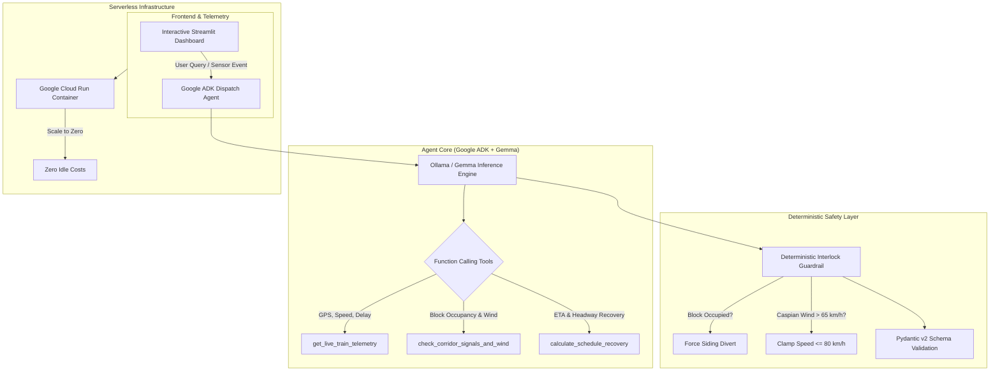
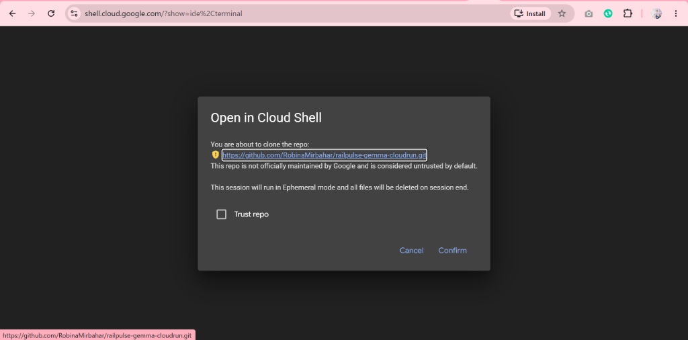
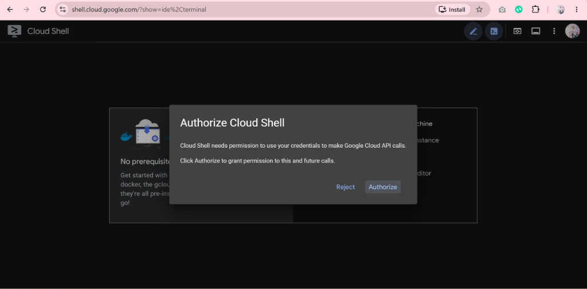
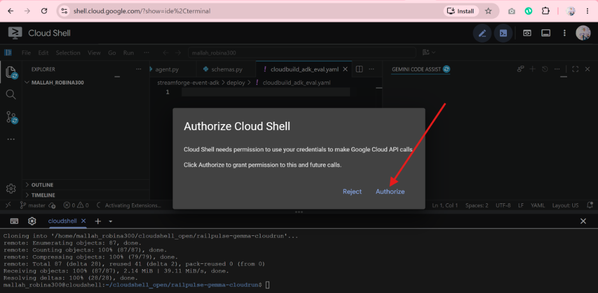
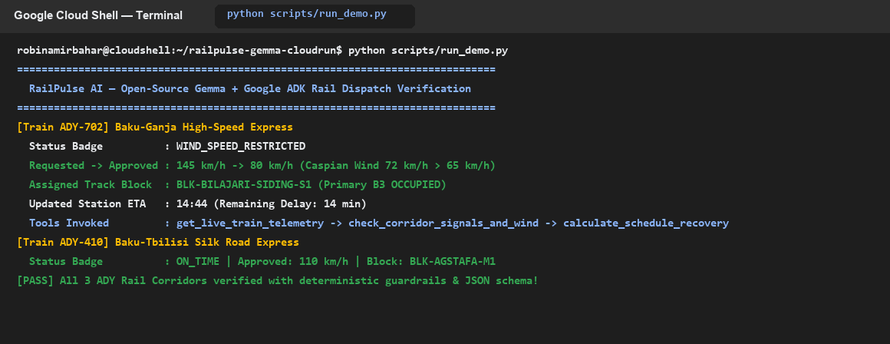
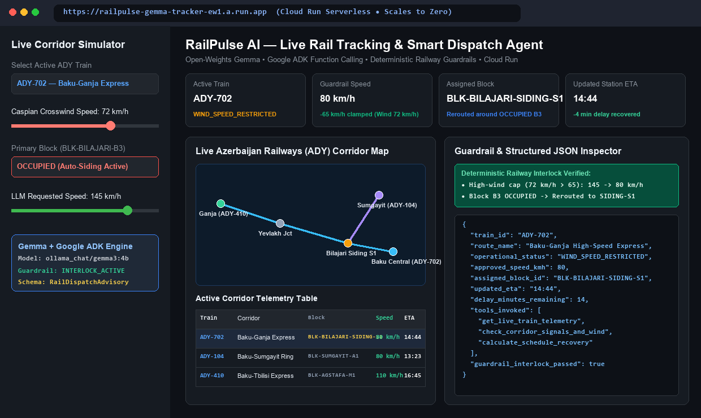
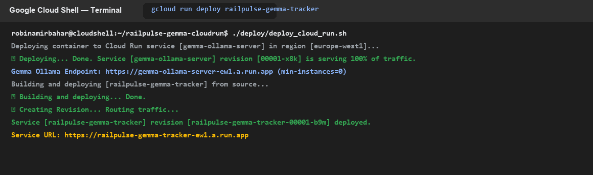

# 🚆 RailPulse AI — Building & Deploying Open-Source AI Agents with Gemma and Google Cloud Run (DevFest Baku 2026)


> **Accepted 45-Minute Hands-On Workshop — DevFest Baku 2026**  
> **Speaker:** [Robina Mirbahar](https://github.com/RobinaMirbahar) (Google Developer Expert in Cloud & AI)  
> **Topic:** Building, containerizing, and deploying a production-ready railway dispatch and tracking AI agent powered by open-weights Gemma, Google ADK, and Google Cloud Run with zero idle costs.

---

## 🎯 Why We Use This Documentation (Purpose & Real-World Value)

Most generative AI tutorials showcase toy chatbots, creative writing prompts, or basic customer service bots. **RailPulse AI addresses a fundamentally different and much higher-stakes engineering challenge: how to build AI agents for safety-critical physical infrastructure.**

Here is why this documentation and architecture are essential:

### 1. 🛡️ Moving Beyond "Toy Demos" to Safety-Critical AI
In passenger rail systems (like Azerbaijan Railways or [Patri](https://patri.hataf.dev/)), a single hallucinated route or ignored signal can cause catastrophe. This documentation demonstrates how to wrap open-weights models (Gemma) inside **deterministic, non-negotiable software interlocks** (`guardrails.py`) so physical safety rules always take precedence over AI suggestions.

### 2. ⚡ 100% Reproducibility with Zero Local Setup Friction
In conference workshops (such as DevFest Baku 2026), attendees arrive with different laptops (macOS, Windows, Linux, Chromebooks) and mismatched Python or CUDA environments. This documentation standardizes the entire 45-minute lab around **Google Cloud Shell** with **1-click launch buttons**, ensuring every developer gets an identical, ready-to-run environment without installing anything locally.

### 3. 💰 Privacy, Data Sovereignty & $0 Idle Serverless Economics
Many enterprise organizations cannot stream sensitive internal operational telemetry, crew rosters, or signal logs to closed third-party cloud APIs. By using **Gemma open-weights models** hosted on **Google Cloud Run with scale-to-zero (`--min-instances 0`)**, teams retain 100% data privacy and control while paying **$0 when the application is idle**.

### 4. 🧭 Dual-Purpose: Live Presentation Playbook & Self-Paced Blueprint
- **For DevFest Baku 2026 Attendees:** Acts as the live step-by-step companion guide during the 45-minute interactive workshop.
- **For the Open-Source Community:** Serves as a reference implementation demonstrating how to combine **Google Agent Development Kit (ADK)**, **Pydantic v2 structured JSON schemas**, **Streamlit**, and **Cloud Run** in production.

---

## 🌟 Real-World Inspiration: From Patri (Live Rail Tracking) to Autonomous Dispatch

**RailPulse AI** is inspired by real-world live transit systems such as **[Patri (پٹڑی)](https://patri.hataf.dev/)**—a progressive web application providing live GPS tracking, station arrival times, and delay telemetry for Pakistan Railways.

While passenger-facing platforms like [patri.hataf.dev](https://patri.hataf.dev/) track where trains currently are, **railway operators and dispatchers face a much harder problem:**
- How do you react in real time when a sudden high crosswind off the Caspian Sea forces speed restrictions?
- Which train gets priority when a primary track block is occupied?
- How can an AI assistant provide intelligent rerouting advisories without ever violating non-negotiable physical railway interlocks?

**RailPulse AI** solves this by pairing Google's open-weights **Gemma** model with **Google Agent Development Kit (ADK)**, deterministic safety guardrails, and serverless **Google Cloud Run** deployment.

---

## 🏗️ Architecture Overview




---

## ⏱️ 45-Minute Hands-On Workshop Lab Guide (Google Cloud Shell)

Everything in this workshop runs entirely inside **Google Cloud Shell**—requiring **zero local software installation**. Bring your laptop, open a browser, and follow along step by step.

```
00:00 ─── [Module 1: Cloud Shell Setup] ─── 05:00
05:00 ─── [Module 2: Gemma Tools & Function Calling] ─── 15:00
15:00 ─── [Module 3: Deterministic Interlocks & Schemas] ─── 25:00
25:00 ─── [Module 4: Live Streamlit Rail Tracker] ─── 35:00
35:00 ─── [Module 5: Serverless Cloud Run Deployment] ─── 45:00
```

---

### Module 1: Cloud Shell Setup (00:00 - 05:00) — Step 1: Open Google Cloud Shell

[](https://shell.cloud.google.com/cloudshell/editor?cloudshell_git_repo=https://github.com/RobinaMirbahar/railpulse-gemma-cloudrun.git)

> **👉 Step 1 Action:** Click the blue **Open in Google Cloud Shell** button above to launch Google Cloud Shell and automatically clone this repository in a single click.

Alternatively, follow the manual console steps below:

1. Open your browser and navigate to the [Google Cloud Console](https://console.cloud.google.com/).
2. In the top navigation bar, click the **Activate Cloud Shell** icon (`>_`).



3. Verify your active Google Cloud project and authenticated account:

```bash
gcloud auth list
gcloud config set project $(gcloud config get-value project)
```



4. Clone the RailPulse AI repository and enter the directory:

```bash
git clone https://github.com/RobinaMirbahar/railpulse-gemma-cloudrun.git
cd railpulse-gemma-cloudrun
```



5. Create and activate a Python 3.11 virtual environment, then install dependencies:

```bash
python3 -m venv .venv
source .venv/bin/activate
pip install -r requirements.txt
```

---

### Module 2: Function Calling & Telemetry Tools (05:00 - 15:00)

In this module, we inspect how the agent queries live train status and track conditions using Python function calling in `railpulse_agent/tools.py`:

- `get_live_train_telemetry(train_id)`: Fetches live GPS coordinates, speed (`km/h`), delay (`minutes`), and current block location for corridors such as the *Baku–Ganja High-Speed Express* (`ADY-EXP-101`) or *Baku–Sumgayit Absheron Commuter* (`ADY-SUB-304`).
- `check_corridor_signals_and_wind(corridor_id)`: Queries track block status (`FREE`, `OCCUPIED`, `MAINTENANCE`) and live Caspian coastal crosswind velocity (`km/h`).
- `calculate_schedule_recovery(train_id, target_speed_kmh, use_passing_siding)`: Runs deterministic timetable math to compute headway recovery and arrival adjustments.

Test the full agent workflow via the CLI runner:

```bash
python scripts/run_demo.py
```



---

### Module 3: Deterministic Interlocks & Structured Outputs (15:00 - 25:00)

> [!IMPORTANT]
> **Safety Rule for AI in Critical Infrastructure:** Large language models must **never** be given unilateral authority to route physical vehicles or override safety interlocks.

In `railpulse_agent/guardrails.py`, RailPulse AI implements a two-tier safety interlock that runs before any advisory is approved:

1. **Track Block Interlock:** If the downstream block is `OCCUPIED`, the agent strictly forbids proceeding along the main line and automatically diverts the train into a verified `FREE` siding loop (`BLK-BILAJARI-SIDING-S1`).
2. **Caspian High-Wind Speed Cap:** If crosswinds off the Absheron peninsula exceed `65 km/h`, the advisory clamps train speed to `<= 80 km/h` regardless of LLM output.
3. **Pydantic v2 Schema Validation (`railpulse_agent/schemas.py`):** Ensures every response conforms strictly to the `RailDispatchAdvisory` JSON structure:

```json
{
  "train_id": "ADY-EXP-101",
  "status": "REROUTED_TO_SIDING",
  "assigned_block": "BLK-BILAJARI-SIDING-S1",
  "max_speed_kmh": 80,
  "headway_recovery_min": 6.5,
  "rationale": "Primary block BLK-GANJA-MAIN-02 is OCCUPIED and Caspian crosswind is 72 km/h. Siding diversion enforced."
}
```

Run the automated test suite to verify the guardrails:

```bash
pytest tests/test_railpulse.py -v
```

---

### Module 4: Launching the Interactive Streamlit Dashboard (25:00 - 35:00)

Launch the interactive dashboard to visualize live train positions, departure boards, and the interactive **Caspian Wind & Block Occupancy Simulator**:

```bash
streamlit run app.py --server.port=8080 --server.address=0.0.0.0
```

1. In the upper-right corner of Google Cloud Shell, click **Web Preview** (`eye icon`).
2. Select **Change port > 8080 > Preview and Run**.



In the dashboard, try:
- Toggling **Caspian Wind Speed** to `> 65 km/h` to see the high-wind safety clamp engage.
- Changing **Track Block 02** from `FREE` to `OCCUPIED` to see the autonomous siding diversion trigger in real time.

---

### Module 5: Deploying to Google Cloud Run (35:00 - 45:00) — Step 5: Serverless Deployment

[](https://deploy.cloud.run/?git_repo=https://github.com/RobinaMirbahar/railpulse-gemma-cloudrun.git)

> **👉 Step 5 Action:** Click the **Run on Google Cloud** button above to deploy your containerized agent directly to Google Cloud Run, or execute the deployment script in your terminal below:

```bash
chmod +x deploy/deploy_cloud_run.sh
./deploy/deploy_cloud_run.sh
```

Or deploy directly with `gcloud`:

```bash
gcloud run deploy railpulse-gemma   --source .   --region europe-west1   --allow-unauthenticated   --memory 2Gi   --cpu 2   --min-instances 0   --max-instances 5
```



When deployment completes, Cloud Run outputs your live service URL:
```text
Service [railpulse-gemma] revision [railpulse-gemma-00001-xyz] has been deployed and is serving 100 percent of traffic.
Service URL: https://railpulse-gemma-xxxxxxxxxx-ew.a.run.app
```

> [!TIP]
> **Scale-to-Zero ($0 Idle Cost):** Because `--min-instances 0` is set, Cloud Run automatically scales container instances down to zero when no HTTP requests are arriving, meaning your workshop demo incurs $0 in idle compute costs.

---

## 📁 Repository Structure

```text
railpulse-gemma-cloudrun/
├── app.py                      # Interactive Streamlit live rail tracking UI & simulator
├── Dockerfile                  # Container definition for Google Cloud Run
├── requirements.txt            # Python dependencies (streamlit, pydantic, google-genai)
├── pyproject.toml              # Build & test configuration
├── deploy/
│   └── deploy_cloud_run.sh     # One-click Cloud Run deployment script
├── railpulse_agent/
│   ├── __init__.py
│   ├── agent.py                # Google ADK agent orchestrator
│   ├── guardrails.py           # Deterministic railway safety interlocks
│   ├── schemas.py              # Pydantic v2 structured JSON advisory models
│   └── tools.py                # Telemetry, signal & timetable recovery tools
├── scripts/
│   └── run_demo.py             # CLI demonstration runner for terminal walkthroughs
├── tests/
│   └── test_railpulse.py       # Unit tests for tools, interlocks & schemas
└── assets/
    ├── railpulse_cover.jpg
    ├── railpulse_architecture.jpg
    └── screenshots/            # Step-by-step workshop screenshots (1 to 6)
```

<!-- AUTHOR_SIGNATURE_START -->
---

## 👩‍💻 About the Author

**Robina Mirbahar — Google Cloud & AI Architect**  
*Google Developer Expert (GDE) in Cloud & AI • Published Author • Multi-Agent Systems & Serverless GPU Builder*

[](https://github.com/RobinaMirbahar)
[](https://medium.com/@robinamirbahar)
[](https://dev.to/robinamirbahar)
[](https://www.linkedin.com/in/robina-mirbahar)
[](https://g.dev/RobinaMirbahar)
[](https://www.youtube.com/@RobinaMirbahar)
[](https://x.com/RobinaMirbahar)
[](https://www.amazon.com/dp/B0D146249R)

<!-- AUTHOR_SIGNATURE_END -->
